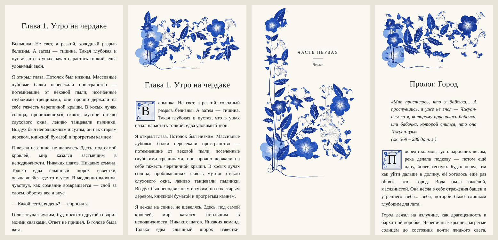
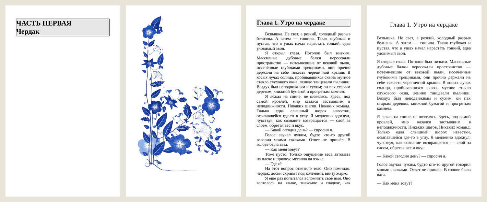

# florilegium для электронных книг


**English.** This is a fork of [kevinraymond/florilegium](https://github.com/kevinraymond/florilegium),
the procedurally grown Delft-blue margins for LuaLaTeX, adapted to put those gardens into e-books.
It adds three things:
- [`js/`](../js/README.md) — a JavaScript port of the garden generator, byte for byte the same SVG as the Lua, so an ePub can regrow a garden to the reader's screen;
- [`ebook-build/`](../ebook-build/SKILL.md) — a Claude skill, in Russian, that builds and verifies ePub, FB2 and MOBI from a Markdown manuscript, with gardens on part-title pages and in chapters;
- [`examples/`](../examples/war-in-heaven/README.md) — a short story built every way the skill can build it.

Upstream's own README is [`README.md`](../README.md); everything there still holds. The rest of this page is in Russian.

---

## Зачем этот форк

[florilegium](https://github.com/kevinraymond/florilegium) Кевина Рэймонда растит на полях страницы акварельный сад: стебли, листья, цветы, бабочки. Всё это кривые, посчитанные в Lua, без единой картинки. Сад получается свой на каждой странице, и под текст он подстраивается.

Мне он понадобился для книги: на шмуцтитулах частей и в начале глав. Оказалось, что для этого нужно почти всё переделать вокруг генератора, но не сам генератор:

- **книгу собирать из Markdown** сразу в ePub, FB2 и MOBI и проверять каждый файл, а не верить ему на слово;
- **сад класть в книгу** так, чтобы его одинаково показали Apple Books, Google Play, PocketBook, Kindle и FBReader, и чтобы книга без сада оставалась той же книгой;
- **сад растить под экран читалки**: у телефона одни пропорции, у планшета другие. Для этого генератор пришлось перенести на JavaScript, а ePub умеет запускать скрипты.

Так появились порт на JS, скилл сборки книг и пример.

## Что внутри

| Папка | Что это |
|---|---|
| [`js/`](../js/README.md) | Порт генератора на JavaScript: страница с садом, заставка главы, концовка, плитка буквицы и скрипты живых страниц ePub. Один файл [`js/dist/florilegium-garden.js`](../js/dist/florilegium-garden.js), около 135 КБ, без зависимостей |
| [`ebook-build/`](../ebook-build/SKILL.md) | Скилл для Claude: сборка ePub, FB2, MOBI, Markdown и фрагментов из глав в Markdown, проверка готовых файлов, режимы, альфа-сборки, сады, переносимый комплект проекта |
| [`examples/war-in-heaven/`](../examples/war-in-heaven/README.md) | Рассказ «Война в Раю», собранный тремя способами: спокойно, с садами, с живым садом |
| всё остальное | florilegium как есть, синхронизируется с автором |

## Как это выглядит

Одна и та же книга, ePub. Слева направо: спокойная глава, глава с садом (заставка и буквица), шмуцтитул части, пролог с эпиграфом.



Живой сад: тот же шмуцтитул на телефоне, на планшете и в альбомной ориентации. Seed один, сад каждый раз растёт под пропорции страницы. При пропорции листа 120:200 вырастает тот же сад, что на статичной картинке.


FB2 и MOBI (здесь их показывает Calibre). Текст поверх картинки FB2 не умеет, поэтому сад встаёт отдельной страницей под заголовком части. MOBI собирается из ePub: в нём остаётся то, что старые Kindle умеют показать.



Скачать и открыть в своей читалке:

| Сборка | ePub | FB2 | MOBI |
|---|---|---|---|
| Спокойная | [epub](../examples/war-in-heaven/книги/Война_в_Раю.epub) | [fb2](../examples/war-in-heaven/книги/Война_в_Раю.fb2) | [mobi](../examples/war-in-heaven/книги/Война_в_Раю.mobi) |
| С садами | [epub](../examples/war-in-heaven/книги/Война_в_Раю_сад.epub) | [fb2](../examples/war-in-heaven/книги/Война_в_Раю_сад.fb2) | — |
| Живой сад | [epub](../examples/war-in-heaven/книги/Война_в_Раю_живой_сад.epub) | — | — |
| Фрагмент: пролог и главы 1–2 | [спокойный](../examples/war-in-heaven/книги/Война_в_Раю_фрагмент.epub), [с садами](../examples/war-in-heaven/книги/Война_в_Раю_фрагмент_сад.epub), [живой](../examples/war-in-heaven/книги/Война_в_Раю_фрагмент_живой_сад.epub) | — | — |

Живой сад виден в Apple Books и в читалках на браузерном движке. Где скриптов нет (e-ink, Kindle, FB2, MOBI), остаётся та же картинка, что в садовой сборке.

## Как собирается книга

Всё, что описывает книгу, лежит в одном `book.json` рядом с главами: порядок глав, части, аннотация, обложка, фрагменты, режимы, сады. Скрипты от книги не зависят. Пример: [`examples/war-in-heaven/book.json`](../examples/war-in-heaven/book.json), все поля — в [`references/config.md`](../ebook-build/references/config.md).

1. **Главы в Markdown.** По файлу на главу, первая строка `# Заголовок`. Поддерживаются курсив, полужирный, отбивки сцен, подзаголовки, цитаты, переносы строк внутри абзаца. Порядок задаётся списком, а не сортировкой имён.
2. **Очистка.** Из глав вырезаются служебные пометки автора: шапки версий, «КОНЕЦ ГЛАВЫ», комментарии, раздел заметок в конце файла. Голая нумерация сцен (`## II`) становится отбивкой, а не исчезает, иначе сцены склеиваются. Список пометок расширяется в `book.json`.
3. **Одна разметка на все форматы.** Очищенный текст один раз превращается в XHTML для ePub и в FB2. Markdown-версия книги и MOBI собираются из того же потока. Формат, который собирался бы своим путём, рано или поздно разошёлся бы с остальными.
4. **Книга.** Обложка, титул, аннотация, при необходимости страница «От автора», затем части со шмуцтитулами и главы, колофон, оглавление. Фрагмент получает страницу «Продолжение следует» под свою точку обрыва, своё название и свой идентификатор, чтобы читалка не заменила им полную книгу.
5. **Сады — по желанию.** `make_gardens.py` растит сады частей Lua-генератором этого репозитория и украшения глав движком на JS. Он снимает маску по краю листа, растрирует в PNG на 256 цветов и подписывает картинку её параметрами, поэтому перерисовывается только изменившееся. Сборка в режиме с садом кладёт их в книгу; спокойная сборка совпадает с прежней байт в байт.
6. **Проверка каждого файла.** `verify_book.py` открывает готовые книги и сверяет их с исходниками:
   - ePub — zip с `mimetype` первым, каждая страница — валидный XML; FB2 — валидный XML; MOBI — обратная конвертация в текст;
   - метаданные, обложка, аннотация;
   - каждая глава на месте: по пять фраз из начала, середины и конца;
   - во фрагменте нет текста из глав за границей;
   - оглавление по порядку, число отбивок, число слов;
   - нет утечек: служебных пометок и сырой разметки (`**`, `#`, `<!--`);
   - проза во всех режимах совпадает слово в слово;
   - в режиме с садом каждая картинка на месте, атрибуты SVG целы, движок из самой книги растит каждый сад.

   Ошибка — книга не выдаётся.
7. **Комплект** по запросу: книги, главы, инструменты и `book.json` в одной папке. Скрипт пересобирает книги прямо из комплекта и сверяет их с исходной сборкой, пишет манифест с md5 и пакует.

## Сложности, на которых всё держится

Каждый пункт здесь — ошибка, которая уже случилась на настоящей книге. Полный список с разбором — в [`references/pitfalls.md`](../ebook-build/references/pitfalls.md).

**Текст и сборка**
- **Проверка, которая ищет то же, что вырезает сборка, ничего не ловит.** Новая служебная шапка автора уходила в книгу на двадцати страницах, а проверка молчала. Теперь утечки ищутся по признакам, а не по точному тексту, и список признаков шире списка вырезки.
- **Допуск «в процент» на всю книгу — это десять абзацев.** На книге в 139 тысяч слов удалённый абзац проходил проверку. Теперь в Markdown-сборке слова сверяются поглавно и точно.
- **`Path("…_бета_2.0").with_suffix(".epub")`** даёт `…_бета_2.epub`. Проверка искала по тому же испорченному имени и ничего не замечала.
- **`***жирный курсив***`** превращался в `<strong><em>…</strong></em>`. ePub это прощал, FB2 падал как невалидный XML.
- **Перемонтаж глав.** Когда автор переразрезал две главы в две другие, diff показывал сплошную красноту. `compare_remontage.py` сравнивает абзацы как множества: что перенесено, что пропало, что дублируется.

**Читалки**
- **ebooklib переводит `viewBox` в `viewbox`.** В XHTML это другой атрибут, и читалка молча ставит сад в чужом масштабе. Страницы с садом поэтому идут в ePub готовым XHTML, мимо парсера.
- **Apple Books держит свои поля даже на странице-картинке.** Кремовый сад с обрезкой «под экран» выглядел вклеенной открыткой со срезанным цветком. Теперь у сада прозрачный фон, вписывание без обрезки, а название части — живой текст цвета темы читалки.
- **Генератор режет сад по краю листа.** На странице LaTeX этот край совпадает с краем бумаги, а на шмуцтитуле он оказывается посреди экрана. Внешние стороны маски снимаются.
- **FB2 не умеет текст поверх картинки, MOBI собирается из ePub**, а **магазины иногда вырезают скрипты**. Поэтому живой сад — всегда надстройка над картинкой, а не замена ей.
- **Calibre из apt ломается от `lxml` из pip.** `setup_env.sh` это чинит.

**Один и тот же сад везде**
- **Синус в браузере и в Lua может отличаться в последнем бите**, а сад растёт жадно: одна такая разница уводит ветку в другую клетку, и дальше растёт другой сад. В порте своя математика (sin, cos, atan, log, exp, pow по алгоритмам fdlibm, только из `+ − × ÷`), одинаковая в JS и Lua.
- **Ещё три ловушки порта.** `^` в Lua не переопределить, поэтому в эталоне он переписан в вызов функции. `%.Nf` в printf округляет точные половинки к чётному, а `toFixed` — нет. `0` в Lua — истина, поэтому `x or d` нельзя переводить как `x || d`.
- **Итог сверки:** 96 страниц разных форматов, зеркальные, сезоны, плотность — байт в байт с `florilegium-svg.lua`. Сверка пересобирает эталон из Lua этого репозитория при каждом запуске (`js/test/`).

## Быстрый старт

```bash
git clone https://github.com/jfoboss/florilegium
cd florilegium/examples/war-in-heaven
bash ../../ebook-build/scripts/setup_env.sh         # ebooklib, Calibre
python3 ../../ebook-build/scripts/make_gardens.py --config book.json
python3 ../../ebook-build/scripts/build_book.py --config book.json --all-modes
```

Для своей книги скопируйте `book.json` примера рядом со своими главами и поменяйте поля. Садам нужны `lua5.4` (или `texlua`), `rsvg-convert`, Pillow и `node`. Спокойной книге не нужно ничего из этого.

### Как скилл для Claude

`ebook-build/` — это скилл: инструкция для Claude и скрипты к ней. С ним достаточно прислать главы и сказать «собери». Claude спросит, чего не хватает (обложку, аннотацию, части), соберёт, проверит и скажет, что нашёл.

- **Claude Code:** скопируйте папку в `~/.claude/skills/ebook-build/`.
- **claude.ai:** упакуйте её командой `zip -r ebook-build.skill ebook-build` и загрузите в настройках, в разделе навыков.

Скопированному отдельно скиллу путь к генератору садов частей нужно указать: `make_gardens.py --florilegium <папка с florilegium-svg.lua>`.

## Синхронизация с florilegium

Форк держится рядом с оригиналом: файлы автора не правятся, всё своё лежит в `js/`, `ebook-build/`, `examples/` и в этом `README` (`.github/README.md`, поэтому `README.md` автора остаётся нетронутым). Обновиться: **Sync fork** на странице репозитория. После этого прогоните сверку порта, она скажет, если автор поменял рисунок:

```bash
LUA=lua5.4 node js/test/page_cross.js
```

## Лицензии и благодарности

- florilegium — © 2026 Kevin Raymond, MIT. Порт на JavaScript и скилл — © 2026 jfoboss, MIT.
- Математика порта следует алгоритмам fdlibm (© 1993 Sun Microsystems, свободная лицензия с сохранением уведомления).
- Рассказ «Война в Раю» и его обложка — © Юрий, все права защищены; в репозитории как пример сборки.
